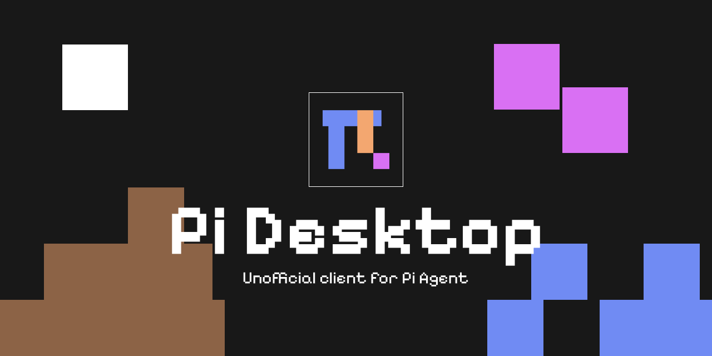

# Pi Desktop

A native Rust (GTK4 + libadwaita) desktop client for talking to Pi over RPC.
Local-first, two columns, three rows, no cloud dependency. SSH is optional for
running Pi on another machine.

Pi Desktop is an independent project by FrameT. It is not affiliated with,
endorsed by, or sponsored by Earendil Inc. The name "Pi" is used only to
describe compatibility with the Pi coding agent.

## Features

- Chat and code modes in one app, switched from the header.
- Sessions, search, tree, artifacts, jobs and Pi extensions.
- 50 food themes, light and dark, searchable in Settings → Personalization.
- Personalization tab for theme, typeface (Pixelify/JetBrains, Adwaita or system)
  and font size.
- Memory, personas, plan mode, permissions, restore points and subagents.
- Weekly GitHub release check on app start, never on a background timer.
- Credits tab with version, links, license and the preinstalled extension bundle.

## Requirements

- Stable Rust
- GTK4 (>= 4.16) and libadwaita (>= 1.5)
- The `pi` binary available on `PATH` or configured in `config.ini`
- The fonts in `resources/fonts/` (installed by the script below)

## Build and install

```sh
cargo build --release
tools/install-fonts.sh
tools/install-icons.sh
```

The executable is installed at `~/.local/bin/pi-desktop`. The installer also
creates the app icon and the desktop menu entry.

## Configuration

The app reads `~/.config/pi-desktop/config.ini`. The `config.ini` in this
repository is a safe example with no machine-specific data:

```ini
[pi]
target=local
bin=~/.local/bin/pi
workspace=~/projects
session_id=desktop
```

To use another machine, set `remote_ssh` and change `target=remote`. No default
server is embedded.

## Preinstalled extensions

- `pi-memory` — durable memory and session search
- `pi-personas` — agent personalities
- `pi-plan` — read-only planning and task progress
- `pi-guard` — permission modes and safety rules
- `pi-checkpoints` — file restore points and rollback
- `pi-web-access` — web search and page extraction
- `pi-subagents` — delegated subagents in the activity rail

## Layout

```text
build.rs                  generates tokens and CSS from resources/tokens-site.json
resources/style.rules.css layout rules, no literal color
resources/style.css       generated at build time; do not edit by hand
resources/fonts/          Pixelify Sans and JetBrains Mono (OFL); Adwaita/system fonts are optional
resources/icons/          pixelarticons and interface icons
resources/brand/          Pi Desktop brand assets
resources/logos/          model provider marks
src/rpc.rs                local or SSH RPC client
src/ui/                   header, sidebar, chat, composer and settings
tools/install-fonts.sh    installs the bundled fonts for the current user
tools/install-icons.sh    installs the executable, icon and desktop entry
```

## License

Copyright (C) 2026 FrameT.

Pi Desktop is free software under the **GNU General Public License v3.0 or
later**. See `LICENSE`.

The license allows use, study, modification and redistribution, including paid
distribution, provided that distributed derivative works remain GPL and offer
the corresponding source code. The GPL does not prohibit selling copies.

The Pi Desktop name, icon and banner live in `resources/brand/` and `design/`.
No official pi.dev logo is included. See `TRADEMARKS.md`.
