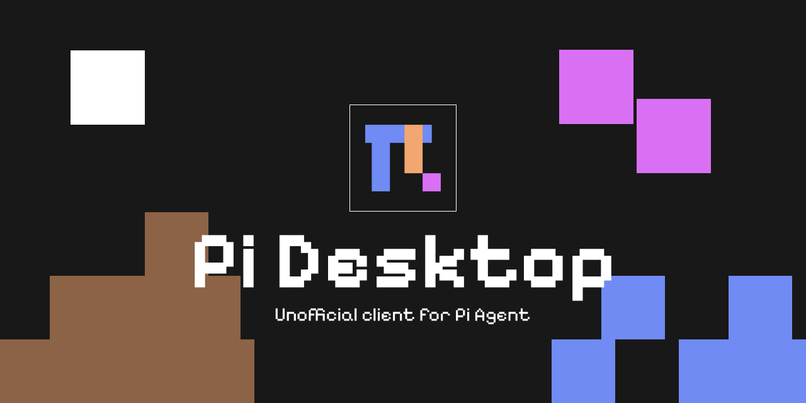

# Pi Desktop

### Stage Fright (1.8.0)

The Git tab uses a [MeGit-inspired workbench](docs/git-workbench.md): compact
Unstaged/Staged lists, click-to-preview diffs, Ctrl/Shift multi-selection,
Stage/Unstage selection or all, and a file filter. While filtering, **Stage shown**
and **Unstage shown** affect only visible files, never hidden changes.
Space/Enter moves selected
files, Ctrl+Enter commits, and Ctrl+F focuses the current filter. The History tab
shows the actual parent graph, refs, author, commit message and changed-file diffs
without changing HEAD or the index (200 commits initially, up to 2,000).
**Open repository…** chooses a local repository independently of the chat
workspace; selecting a subfolder resolves its repository root. The active path
is always shown. **Use workspace** restores automatic following. This choice
lasts for the current app run, and switching preserves per-repository commit
message drafts in memory. Invalid selections or cancelling do not replace the
active repository. No repository is created or searched for recursively.
Polling preserves selection. It also supports branches, Fetch, fast-forward-only
Pull, Publish and merge/rebase recovery. **Discard** saves a recoverable stash;
**Destroy** requires confirmation. File actions are in the right-click menu
(Menu or Shift+F10 from the keyboard). Stashing before a repository's first commit
is not supported by Git and leaves the file untouched.

The [focused Git UX pass](docs/git-ux.md) keeps the current branding with a
compact header and local tabs. **More…** holds New branch and manual Refresh.
Commit becomes available only with staged files, a nonblank message and no
conflicts. Clean and no-match states explain the next action; successful
operations use a short confirmation, with detailed Git output in its tooltip.

Responses stream by default. Enable **Prefer waiting for responses** in
Settings → Interface to show only the completed response. Plan approvals stay in
the bottom bar until answered. One plan shows **Plan · Execute · Stay in plan ·
Refine** inline, with only a soft background behind Plan and no inner frame.
Session-labelled menus appear only when more than one plan is pending.
Plan tasks live in the rail in both view modes.
Window size, maximized state and rail layout persist. Wayland controls window
position.

The sidebar, Credits, Updates and `--version` all read the application's
`APP_VERSION`, derived at build time from `Cargo.toml`; no UI label owns a
separate version number. This is the desktop app version, not the Pi RPC server's.

Offline UI checks: `python3 tools/verify-ui.py` (PNGs and measurements in
`dist/qa/1.8.0`). Use `--output PATH`, `--temp-root PATH` or `--font-scale 125`.
Checks use a private headless Mutter compositor and D-Bus session by default:
no test windows appear on the desktop. `mutter` and `dbus-run-session` are
development prerequisites. Visible tests require the explicit `--interactive` flag.
The opt-in `--live-stream live-stream live-wait` cases make two ephemeral model
calls with tools disabled. They are not part of the offline regression suite.

A native desktop app for the Pi coding agent, written in Rust with GTK4 and
libadwaita. It talks to Pi over RPC, either on the same machine or over SSH.

[](https://www.deepseek.com/)
[](https://openai.com/codex/)

DeepSeek and Codex were used as development tools on this project. Neither is
needed to build or run the app.

Pi Desktop is an independent project by FrameT. It is not affiliated with or
endorsed by Earendil Inc. The name "Pi" is used only to describe compatibility
with the Pi coding agent.

## What it does

Chat and code modes live in the same window, and the header switches between
them. The sidebar holds the sessions, the session tree, artifacts, tasks, Git
review and the installed extensions. `Ctrl+K` searches commands and sessions,
`Ctrl+F` searches inside the open chat, and `Ctrl+Shift+F` searches every
session.

**Turn feedback.** A 1px pulse sits under the message you sent, and a receipt
under the reply reports its phase (sent, thinking, tools, writing, done), the
elapsed time and the token count. Markdown links open the system browser, and
each message has its own copy button.

**Sessions stay alive.** Every session runs in its own Pi RPC process, so
starting a new session while a turn is running leaves that turn running, and
switching back attaches to the process that is still there. Running sessions are
marked in the sidebar and in the tabs, and a permission prompt that arrives in
the background waits until you open that session.

**Long sessions stay cheap.** The newest messages come first. History is a tail
of the last 20 messages with a "load earlier" button that pages backwards, and
tool and diff cards start collapsed, so an old session does not build thousands
of widgets and keep them alive.

**Attachments.** Images collect into a thumbnail strip, and any other file (PDF,
source, CSV, Office document) becomes a card. Text is inlined for the agent and
PDFs are read with `pdftotext` when it is installed. Consecutive images can
instead share a carousel in the chat, outside the tool cards, where a click
enlarges them. Settings → Model turns the carousel off.

**Context you control.** `/compact [focus]` summarizes the old context and
reports the estimated tokens saved, while Pi's own automatic compaction stays
enabled. Compact Memory, Personality and System Prompt work the same way in
Settings. Choose a model the local Pi has, read the shorter draft, then save.

**Clarify questions.** A turn can end with a multiple-choice question that
always accepts free text. The desktop shows it as a card and sends a system
notification, and Settings → Model → features turns it off.

**Sub-agents.** A tier of best, balanced or cheap resolves inside the model
family of the current session, with a pick per family, and is written to Pi's
`settings.json` as `subagents.defaultModel` plus per-provider overrides. Their
status appears in a resizable activity rail, and the reasoning picker only
offers levels the model actually supports.

**Appearance.** 50 food themes, light and dark, searchable in
Settings → Personalization, where the typeface (Pixelify, JetBrains, Adwaita or
the system one) and the font size are set. Light and dark are chosen separately,
and the header toggle switches between the two saved choices without resetting
either, in Chat and Code modes.

**Workspace cleanup.** Right-click a project group to move its sessions to the
trash. Five or more sessions ask three times first. The trash button in the
sidebar footer brings them back for 14 days. The project folder itself is never
deleted, and cleanup only touches local sessions for now.

**Extensions.** Memory, personas, plan mode, permissions, restore points and
subagents are built in. Those that expose settings can be configured from the
app: search, memory, personas and MCP open a settings page, while guard,
subagents and openwiki open their config file.

**Window and tabs.** Windowed mode is draggable from the header, with a
double-click to maximize. Session tabs are opt-in (`[ui] session_tabs=true`),
and the sidebar shows when each session last answered and which model answered.

**Updates.** The app checks GitHub for a new release when it starts, never on a
timer. The Updates tab has a manual check, release links and AppImage downloads,
and labels the prereleases. The Credits tab carries the version, links, license
and the preinstalled extension bundle.

## Requirements

- Stable Rust (1.83 or newer)
- GTK4 (>= 4.16) and libadwaita (>= 1.5)
- The `pi` binary available on `PATH` or configured in `config.ini`
- The fonts in `resources/fonts/` (installed by the script below)

## Install

```sh
curl -fsSL https://framet-bit.github.io/Pi-Desktop/install.sh | bash
```

The same URL is the project's landing page, at <https://framet-bit.github.io/Pi-Desktop/>.

The installer builds the latest release from source and installs it into the
current user's home, as `~/.local/bin/pi-desktop` plus the desktop entry, the
icons and the bundled fonts. It compiles at low priority with half the cores and
keeps a reusable cache, so a later run only rebuilds what changed. Interrupting
it is safe, the next run continues. Nothing is written outside your home.

Maintenance uses the same command.

```sh
curl -fsSL ... | bash -s -- --update      # rebuild the latest release
curl -fsSL ... | bash -s -- --status      # show what is installed
curl -fsSL ... | bash -s -- --uninstall   # remove the app; keep settings
curl -fsSL ... | bash -s -- --dry-run     # print the plan; write nothing
```

Only the GTK4 development packages need root, and only on the first run.

| system | GTK4 | supported |
|---|---|---|
| Fedora 41 or newer | 4.16+ | yes |
| Ubuntu 25.04 or newer | 4.18+ | yes |
| Debian 13 or newer | 4.18+ | yes |
| Arch, openSUSE Tumbleweed | current | yes |
| Ubuntu 24.04 LTS, Debian 12 | 4.14, 4.8 | no, GTK4 is too old |

When GTK4 is too old the installer stops before writing anything and asks
whether to upgrade the distribution, which is the recommended path, or to build
inside a rootless podman container with `--container`. That build leaves the
system packages untouched.

## One-click setup from a checkout

```sh
./setup.sh
```

The setup wizard installs into the current user's home, as
`~/.local/bin/pi-desktop` plus the desktop entry, icons and bundled fonts. It
does not need root.

Non-interactive and maintenance modes use the same script.

```sh
./setup.sh --no-gui       # terminal install, no wizard
./setup.sh --dry-run      # print the plan; write nothing
./setup.sh --status       # show installed files
./setup.sh --uninstall    # remove the app; keep user data and config
```

If GTK4/PyGObject are unavailable for the system Python, the wizard falls back
to the terminal installer. Building still needs Rust and GTK4 development files.

## Build and install from source

```sh
cargo build --release
tools/install-fonts.sh
tools/install-icons.sh
```

The executable is installed at `~/.local/bin/pi-desktop`. The installer also
creates the app icon and the desktop menu entry.

## Configuration

The app reads `~/.config/pi-desktop/config.ini`. The `config.ini` in this
repository is a safe example with no machine-specific data:

```ini
[pi]
target=local
bin=~/.local/bin/pi
workspace=~/projects
session_id=desktop
```

To use another machine, set `remote_ssh` and change `target=remote`. No default
server is embedded.

## Preinstalled extensions

- `pi-memory` — durable memory and session search
- `pi-personas` — agent personalities
- `pi-plan` — read-only planning and task progress
- `pi-guard` — permission modes and safety rules
- `pi-checkpoints` — file restore points and rollback
- `pi-web-access` — web search and page extraction
- `pi-subagents` — delegated subagents in the activity rail

## Provider logos

The header model chip and the model list draw a 24 or 28 px pixel mark for each
provider, and fall back to the provider initial when there is no mark. The marks
are generated from `resources/logos/src/` by `tools/gen-logos.sh`, which drives
`tools/pixelify.py`. The grid and sampling chosen for each slug, with the sources
and licenses, are in `resources/logos/src/README.md`.

The OpenRouter and Ant Ling marks are simplified glyphs drawn for this project,
because no usable monochrome asset existed. The rest come from Simple Icons or
from the provider's own favicon or press mark.

## Layout

```text
install.sh                builds from source and installs for the current user
build.rs                  generates tokens and CSS from resources/tokens-site.json
resources/style.rules.css layout rules, no literal color
resources/style.css       generated at build time; do not edit by hand
resources/fonts/          Pixelify Sans and JetBrains Mono (OFL); Adwaita/system fonts are optional
resources/icons/          pixelarticons and interface icons
resources/brand/          Pi Desktop brand assets
resources/logos/          model provider marks
src/rpc.rs                local or SSH RPC client
src/ui/                   header, sidebar, chat, composer and settings
tools/install-fonts.sh    installs the bundled fonts for the current user
tools/install-icons.sh    installs the executable, icon and desktop entry
```

## License

Copyright (C) 2026 FrameT.

Pi Desktop is free software under the **GNU General Public License v3.0 or
later**. See `LICENSE`.

The license allows use, study, modification and redistribution, including paid
distribution, as long as distributed derivative works stay under the GPL and
ship the corresponding source. Selling copies is allowed.

The Pi Desktop name, icon and banner live in `resources/brand/` and `design/`.
No official pi.dev logo is included. See `TRADEMARKS.md`.

## AppImage

Build a portable x86_64 AppImage with:

```sh
packaging/build-appimage.sh
```

The artifact is written to `dist/Pi-Desktop-<version>-x86_64.AppImage`.
